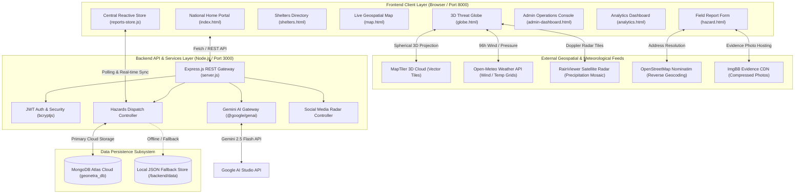

# GeoNetra · National Intelligent Hazard Monitoring & Situational Telemetry Platform

> **Government-Grade Hazard Awareness, Crowdsourced Field Telemetry, 3D Planetary Meteorological Forecasting, and Emergency Relief Dispatch Directory**

[](https://nodejs.org)
[](https://www.mongodb.com/atlas)
[](https://ai.google.dev)
[](https://www.maptiler.com)
[](https://leafletjs.com)

---

## 📌 1. Project Overview

**GeoNetra** (Sanskrit for *"Earth Eye"*) is an end-to-end disaster intelligence, geospatial monitoring, and public safety coordination platform. Engineered for disaster management agencies (such as NDMA and SDMAs), municipal authorities, field observers, emergency responders, and citizens, GeoNetra unifies:
* **Crowdsourced Field Incident Reporting:** Geotagged, image-verified field reports with client-side photo compression, mandatory pin confirmation, and Nominatim reverse geocoding.
* **AI Bilingual Telemetry Digest:** Automated extraction and structured bilingual summarization (English, Hindi, and source language) powered by **Google Gemini 2.5 Flash**.
* **3D Planetary Meteorological Globe:** Interactive spherical Earth projection combining real-time **Open-Meteo** atmospheric winds, **RainViewer** satellite Doppler radar composites, and live hazard markers with a 96-hour forecast timeline scrubber.
* **Emergency Shelters GIS Directory:** Dual-panel relief center workspace featuring GPS proximity dispatch via the Haversine spherical distance formula, live bed occupancy meters, and one-click evacuation navigation.
* **Live Geospatial Map & Social Media Radar:** Fullstage Leaflet GIS map with cluster markers, detailed slide-in incident drawers, and Gemini-powered social feed scanning to detect emergent threats before official dispatch.
* **National Operations Admin Console:** Executive triage center for report moderation, verification badging, threat level escalation, and high-alert priority pinning.
* **Resilient Dual-Mode Data Architecture:** Powered primarily by **MongoDB Atlas** with automated local JSON fallback and seamless auto-migration to guarantee zero downtime during network isolation.

---

## 🚨 2. Problem Statement & Motivation

During natural disasters (cyclones, flash floods, landslides, urban flooding) and industrial accidents:
1. **Communication Fragmentation:** Citizen reports flood unorganized social channels (X, Reddit, local messaging) with missing coordinates and unstructured text, delaying official response times.
2. **Language Barriers:** In diverse nations like India, emergency warnings and localized ground observations often fail to translate rapidly across vernacular languages and official command languages.
3. **Disconnected Evacuation Logistics:** Affected citizens struggle to locate operational relief camps with available bed capacity, clean water, medical aid, or wheelchair access during crises.
4. **Isolated Meteorological Data:** Field response teams frequently lack unified tools that simultaneously display real-time weather radar, forecast wind vectors, and active citizen hazard pins on a single geospatial canvas.

**Motivation:** GeoNetra bridges this critical operational gap by establishing a unified, resilient, accessible command portal linking citizens on the ground directly with nodal emergency authorities.

---

## 💡 3. Proposed Solution

GeoNetra implements a layered, zero-failure architectural solution:
1. **Rapid Field Intake:** Citizens capture photo evidence, auto-detect GPS coordinates, and submit reports with client-side compression to conserve cellular bandwidth in disaster areas.
2. **Automated AI Triage:** Google Gemini 2.5 Flash ingests raw field narratives and returns validated two-sentence summaries in English, Hindi, and the vernacular original.
3. **Dual Spatial Visualization:**
   * **2D Tactical GIS Map:** High-speed Leaflet canvas for localized incident clustering, severity filtering, and verification voting.
   * **3D Strategic Planetary Globe:** MapTiler spherical projection depicting regional atmospheric isobar dynamics, Doppler precipitation echoes, and cross-border weather trajectories.
4. **Proximity Relief Dispatch:** Instant spatial calculation matches stranded citizens to the nearest verified evacuation shelters, providing turn-by-turn navigation and direct hotline calling.
5. **High-Availability Persistence:** MongoDB Atlas synchronization keeps field teams coordinated across devices, while local storage guarantees operations continue uninterrupted during server disconnections.

---

## 🌟 4. Feature Implementation Matrix

| Feature Module | Implementation Status | Technical Implementation Details |
| :--- | :---: | :--- |
| **3D Meteorological & Threat Globe** | 🟢 **Fully Implemented** | MapTiler SDK 3D spherical Earth (`projection: "globe"`), Open-Meteo multi-layer wind dynamics, RainViewer radar tiles, 96h timeline scrubber, live MongoDB Atlas pin sync. |
| **Emergency Shelters GIS Directory** | 🟢 **Fully Implemented** | Master dataset of verified shelters, Leaflet GIS split-panel, Haversine proximity computation, capacity occupancy meters, amenities filters, Google Maps turn-by-turn dispatch. |
| **Field Hazard Reporting Console** | 🟢 **Fully Implemented** | Canvas-based JPEG compression (`compressImage`), Nominatim reverse geocoding, mandatory Leaflet pin confirmation, ImgBB photo CDN upload, Gemini AI summary review. |
| **AI Bilingual Summarization** | 🟢 **Fully Implemented** | Node.js `@google/genai` backend endpoint (`/api/generate-summary`) with structured JSON schema (`summaryOriginal`, `summaryEnglish`, `summaryHindi`, `sourceLanguage`) and deterministic heuristic fallback. |
| **Social Media Radar** | 🟡 **Partially Implemented** | Scrapes Reddit r/jaipur or loads `mock-reddit.json` in demo mode, parses emergency events via Gemini NLP with coordinate geocoding. Live mode depends on public Reddit rate limits. |
| **Live Geospatial Hazard Map** | 🟢 **Fully Implemented** | Leaflet.js fullstage canvas, custom SVG markers, dynamic clustering, slide-in glassmorphic hazard details drawer, upvote/downvote verification engine. |
| **National Operations Admin Console**| 🟢 **Fully Implemented** | Executive KPI stat cards, moderation queue (`manage-reports.html`), report pinning (`pinned-hazards.html`), citizen verification desk (`verification.html`). |
| **Bklit UI Analytics Dashboard** | 🟢 **Fully Implemented** | Dual-gradient Chart.js intake trends, animated shimmering counters, hazard correlation matrix, Leaflet multi-hazard density heatmap. |
| **Multi-Role Authentication & RBAC** | 🟢 **Fully Implemented** | Stateless JWT tokens, bcrypt password hashing, session storage persistence, distinct command views for `admin` vs `Field Monitor`. |
| **Safety Advisories & SOPs** | 🟢 **Fully Implemented** | Level-4 disaster SOP checklists (Cyclones, Floods, Landslides, Chemical), 72-hour survival kit visual checklist, 24/7 verified hotline directory (`1078`, `112`, `1554`). |
| **Satellite SAR Flood Inundation** | ⚪ **Planned** | Planned integration with ISRO/Copernicus Sentinel-1 SAR flood extent geotiffs. |
| **Common Alerting Protocol (CAP) SMS**| ⚪ **Planned** | Planned integration with NDMA / C-DOT national CAP SMS gateway. |

---

## 🏗️ 5. System Architecture & Workflow



### Application Execution Workflow
1. **Intake:** A citizen accesses `hazard.html`, captures or attaches a photo (automatically compressed to $< 500\text{ KB}$), drops a pin on the Leaflet map, and types an incident description.
2. **AI Processing:** Clicking *"Generate AI Summary"* transmits the report to `POST /api/generate-summary`. Gemini 2.5 Flash detects the language and returns synchronized summaries in original vernacular, English, and Hindi.
3. **Verification & Broadcast:** The citizen confirms the summary and submits. The incident is dispatched to `POST /api/hazards`, persisted in MongoDB Atlas, and instantly broadcast to the reactive client store.
4. **Operational Triage:** Administrators on `admin-dashboard.html` view incoming incidents in real-time, adjust severity, dispatch relief, pin critical alerts to the national board, or mark zones resolved.
5. **Public Navigation:** Stranded individuals open `shelters.html`. The browser's Geolocation computes real-time spherical distances to all nearby camps, highlights occupancy, and provides one-click driving navigation.

---

## 💻 6. Technology Stack & Component Roles

### Backend Services (`/backend`)
* **Node.js (v18+) & Express.js (v4.21):** Core REST API gateway handling incident ingestion, user authentication, profile management, and external service proxies.
* **MongoDB Atlas & Mongoose (v9.11):** Scalable cloud document database modeling `users`, `hazards`, and `verified_reporters` collections with secondary indexes.
* **Google Gemini 2.5 Flash (`@google/genai` v1.0):** State-of-the-art multilingual LLM performing structured JSON bilingual hazard summarization and unstructured social media threat identification.
* **Stateless JWT (`jsonwebtoken` v9.0):** Signed 7-day authentication tokens for role-based route security.
* **Bcrypt.js (v3.0):** Salted password hashing (10 rounds) protecting account credentials.
* **CORS & Dotenv:** Cross-origin request whitelisting and environment configuration isolation.

### Frontend Client (`/combined`)
* **Core Runtime:** Vanilla JavaScript (ES Modules) — zero heavy build step required, enabling instant execution and auditability.
* **MapTiler SDK JS (v3.0) & MapLibre GL:** Powers the dedicated 3D spherical planetary globe with momentum physics and elevation zoom.
* **Leaflet.js (v1.9) & Leaflet.heat:** Powers the 2D tactical incident map, dynamic cluster markers, and density heatmaps.
* **Chart.js (v4):** Renders high-frequency dual-gradient area charts and intake curves on the Analytics console.
* **Lucide Icons:** Vector interface iconography for tactical clarity.
* **Design Architecture (Bklit UI):** Bespoke CSS custom tokens combining Obsidian (`#09090b`), Pure White (`#ffffff`), and Royal Indigo (`#2C3480`) with glassmorphic and claymorphic accents.

---

## 📡 7. Verified APIs, AI Models & Datasets

| Source / Model | Verified Endpoint / Resource | Operational Role |
| :--- | :--- | :--- |
| **Google Gemini 2.5 Flash** | `gemini-2.5-flash` via `@google/genai` | Structured bilingual hazard summaries (`summarySchema`) and social emergency NLP (`hazardRadarSchema`). |
| **Open-Meteo API** | `https://api.open-meteo.com/v1/forecast` | Global 10m wind velocity grids, temperature, surface pressure, and isobars. |
| **RainViewer API** | `https://api.rainviewer.com/public/weather-maps.json` | Global satellite Doppler radar composite tile mosaic. |
| **MapTiler Cloud** | `https://api.maptiler.com/maps/dataviz-dark/style.json` | Dataviz Dark 3D planetary vector basemap tiles. |
| **Nominatim Geocoding** | `https://nominatim.openstreetmap.org/reverse` | OpenStreetMap reverse geocoding from latitude/longitude to street address. |
| **ImgBB CDN** | `https://api.imgbb.com/1/upload` | Cloud hosting for compressed field incident evidence photos. |
| **Master Shelters Dataset** | Embedded in `shelters.js` (50+ verified locations) | Verified relief camps across Mumbai, Odisha, Chennai, and Kerala with capacity, contact numbers, and amenities. |

---

## 📋 8. Installation Prerequisites

Before running GeoNetra locally, ensure you have:
* **Node.js:** v18.0.0 or higher (`node -v`)
* **Python 3:** Python 3.8+ (used for the static HTTP client server: `python --version`)
* **Git:** Installed and available in PATH
* *(Optional)* A free **Google Gemini API Key** from [Google AI Studio](https://aistudio.google.com/) for live AI features.
* *(Optional)* A **MongoDB Atlas** cluster URI (the project automatically falls back to local JSON if omitted).

---

## ⚙️ 9. Local Setup & Execution Guide

### Step 1: Clone Repository
```bash
git clone https://github.com/<your-username>/<your-repo-name>.git
cd "Geo Netra"
```

### Step 2: Configure Environment Variables
Copy the template configuration inside `backend/`:
```bash
cd backend
cp .env.example .env
```
Open `backend/.env` in any text editor and configure your variables:
```env
# Google Gemini API Key (Required for live AI summaries & Social Radar)
GEMINI_API_KEY=your_gemini_api_key_here

# Backend Service Port (Default: 3000)
PORT=3000

# MongoDB Atlas URI (Leave blank to run in zero-config local JSON mode)
MONGODB_URI=mongodb+srv://<username>:<password>@cluster.mongodb.net/geonetra_db?retryWrites=true&w=majority

# JWT Authentication Secret
JWT_SECRET=geonetra-secure-jwt-key-2026-secret
```

### Step 3: Start the Backend Service
From the `backend/` directory:
```bash
npm install
npm start
```
* **API Service:** `http://localhost:3000`
* **Health Check:** `http://localhost:3000/api/health`

### Step 4: Start the Frontend Application
Open a new terminal window, navigate to the `combined/` directory:
```bash
cd combined
python -m http.server 8000
```
* **Frontend Portal:** [http://localhost:8000](http://localhost:8000)

---

## 🧪 10. Verification & Test Commands

You can verify code syntax and API integrity using standard commands:

```bash
# 1. Backend Syntax Check
cd backend
node --check server.js db.js

# 2. Test API Health Check (PowerShell)
Invoke-RestMethod -Uri "http://localhost:3000/api/health"

# 3. Test Hazards API Intake
Invoke-RestMethod -Uri "http://localhost:3000/api/hazards"

# 4. Test Social Media Radar (Demo Mode)
Invoke-RestMethod -Uri "http://localhost:3000/api/scan-reddit?mode=demo"

# 5. Test AI Bilingual Summary Endpoint
Invoke-RestMethod -Uri "http://localhost:3000/api/generate-summary" -Method Post -ContentType "application/json" -Body '{"rawText":"Severe storm surge at Marine Drive promenade."}'
```

---

## 🔐 11. Pre-Configured Demo Credentials

The platform includes pre-configured demo credentials for hackathon evaluation and evaluation panels:

| Role | Username / Identifier | Password | Accessible Interfaces |
| :--- | :--- | :--- | :--- |
| **System Administrator** | `admin@geonetra.com` *(or `admin`)* | `Admin@1234` | Full Command Center, Report Moderation, Pinned Hazards Board, Observer Verification Console, 3D Globe, Shelters |
| **Field Monitor / Observer** | `observer@geonetra.gov.in` | `Password@123` | Public Portal, 3D Globe, Shelters Directory, Field Hazard Reporting, Live Geospatial Map, Analytics |

---

## 📁 12. Project Folder Structure

```text
Geo Netra/
├── .env.example                  # Root environment configuration template
├── .gitignore                    # Git ignore rules (node_modules, .env, OS files)
├── CHANGELOG.md                  # Comprehensive architectural changelog
├── CLEANUP_REPORT.md             # Formal engineering audit and cleanup report
├── PRESENTATION_CONTENT.txt      # 6-slide technical viva / hackathon presentation script
├── README.md                     # Official project documentation (this file)
├── TEAM_DISTRIBUTION.txt         # 4-member role distribution and GitHub collaboration guide
│
├── backend/                      # Central REST API & Database Service
│   ├── .env                      # Active environment configuration (git-ignored)
│   ├── .env.example              # Backend environment template
│   ├── .gitignore                # Backend ignore rules
│   ├── db.js                     # MongoDB Atlas Mongoose connection, schemas & local fallback
│   ├── mock-reddit.json          # Offline fallback dataset for Social Media Radar
│   ├── package.json              # Backend dependencies & scripts
│   ├── package-lock.json         # Pinned dependency lockfile
│   ├── server.js                 # Express routes (Auth, Hazards, AI, Verification, Radar)
│   └── data/                     # Local fallback storage and seed datasets
│       ├── hazards.json          # Local incident database
│       ├── users.json            # Local user accounts database
│       └── verified_reporters.json # Local verified observer credentials
│
└── combined/                     # Frontend Client Web Application
    ├── advisories.html           # Root redirect stub to HTML/advisories.html
    ├── analytics.html            # Root redirect stub to HTML/analytics.html
    ├── dashboard.html            # Root redirect stub to HTML/dashboard.html
    ├── globe.html                # Root redirect stub to HTML/globe.html
    ├── hazard.html               # Root redirect stub to HTML/hazard.html
    ├── index.html                # National Home Portal (with live Recent Reports)
    ├── login.html                # Root redirect stub to HTML/login.html
    ├── map.html                  # Root redirect stub to HTML/map.html
    ├── profile.html              # Root redirect stub to HTML/profile.html
    ├── shelters.html             # Root redirect stub to HTML/shelters.html
    ├── globe.js                  # Modular 3D Globe telemetry & layer engine (MapTiler + Open-Meteo)
    ├── hazard-submit.js          # Field hazard submission, JPEG compression & Gemini AI summary
    ├── reports-store.js          # Central reactive data store (MongoDB Atlas sync & caching)
    ├── script.js                 # Global navigation, routing, auth guards & admin desk
    ├── shelters.js               # Emergency Shelters GIS directory controller (Haversine dispatch)
    │
    ├── assets/                   # Vector logos and photographic assets
    │   ├── geonetra-logo.svg     # Official GeoNetra Circular Eye Emblem
    │   ├── IMG-20190805-WA0058.jpg
    │   ├── christian-joudrey-u_nsiSvPEak-unsplash.jpg
    │   ├── pexels-asadphoto-1456291.jpg
    │   └── pexels-spacex-586056.jpg
    │
    ├── CSS/                      # Modular Design System Stylesheets
    │   ├── admin.css             # Admin command center & moderation queue styles
    │   ├── advisories.css        # Safety advisories & emergency SOP styling
    │   ├── analytics.css         # Bklit UI area charts & telemetry styling
    │   ├── auth.css              # Authentication card & credentialing styling
    │   ├── dashboard.css         # Operations overview module cards styling
    │   ├── globe.css             # Dedicated 3D Globe viewport & HUD styling
    │   ├── hazard.css            # Field report form & location pinning styling
    │   ├── index.css             # Home hero & Recent Reports table styling
    │   ├── login.css             # Login & registration portal styling
    │   ├── map.css               # Live map canvas & slide-in details panel styling
    │   ├── profile.css           # Observer profile & security settings styling
    │   ├── shelters.css          # Split shelters list & GIS map styling
    │   └── style.css             # Global tokens, single-tier header & footer styles
    │
    └── HTML/                     # Primary Application Page Views
        ├── admin-dashboard.html  # Admin Command Center overview
        ├── advisories.html       # Official disaster safety advisories & hotline
        ├── analytics.html        # Incident analytics dashboard & Bklit UI telemetry
        ├── dashboard.html        # Operations module desk
        ├── globe.html            # Dedicated 3D Planetary Meteorological Globe
        ├── hazard.html           # Submit field hazard report
        ├── login.html            # Unified sign in & citizen account registration
        ├── manage-reports.html   # Report moderation & incident queue
        ├── map.html              # Live geospatial hazard map & Social Radar
        ├── pinned-hazards.html   # High-priority pinned incident board
        ├── profile.html          # Citizen observer profile & credential settings
        ├── shelters.html         # Emergency Shelters & Relief Camps Directory
        └── verification.html     # Citizen reporter verification console
```

---

## 👥 13. Team Workstream Distribution

The project is structured into four balanced, complementary workstreams (documented in detail in [`TEAM_DISTRIBUTION.txt`](TEAM_DISTRIBUTION.txt)):

* **Member 1 (Frontend & User Experience):** Responsible for UI components, responsive layout, navigation bar, modal dialogs, and user interaction flows.
* **Member 2 (AI/ML & Planetary Meteorological Analysis):** Responsible for Google Gemini 2.5 Flash bilingual prompt engineering, 3D MapTiler globe projection, Open-Meteo wind vectors, and RainViewer radar layers.
* **Member 3 (Backend, Database & External Telemetry Integrations):** Responsible for Express.js endpoints, MongoDB Atlas schemas, JWT session security, local file fallback resilience, and reverse geocoding.
* **Member 4 (Testing, DevOps, Documentation & Demo Preparation):** Responsible for end-to-end flow validation, cross-browser compatibility, git release workflow, `README.md`, `CLEANUP_REPORT.md`, and hackathon presentation staging.

---

## ⚠️ 14. Known Limitations & Future Improvements

1. **Gemini API Rate Limiting (Free Tier):** Google AI Studio free tier limits requests to 20 calls/day per project. GeoNetra implements an automatic heuristic fallback in `server.js` to ensure zero crashes during presentations, but operational production environments should utilize a standard pay-as-you-go quota.
2. **Browser Geolocation:** Accurate real-time GPS distance calculation to shelters requires the user to approve browser location access. If denied, the platform defaults to central coordinates (Mumbai / Central India).
3. **Satellite Radar Refresh Cycle:** RainViewer Doppler composites update at 10-minute intervals corresponding to radar scan passes, rather than instantaneous sub-second live feeds.
4. **Planned Offline PWA Support:** Future iterations will package GeoNetra as an installable Progressive Web App (PWA) with Service Workers to support offline report caching during prolonged telecommunications blackouts.

---

## 📚 15. Research & Reference Standards

* **National Disaster Management Authority (NDMA):** [National Disaster Management Guidelines](https://ndma.gov.in/) for standard operational emergency classifications.
* **India Meteorological Department (IMD):** [Standard Cyclone and Weather Warning Protocols](https://mausam.imd.gov.in/).
* **MapTiler SDK & WebGL 3D Globe Projection:** [MapTiler Globe Documentation](https://docs.maptiler.com/sdk-js/).
* **Open-Meteo Weather Forecast Model:** [Open-Meteo API Documentation](https://open-meteo.com/en/docs).
* **RainViewer Satellite Doppler Composite API:** [RainViewer API Documentation](https://www.rainviewer.com/api.html).
* **Google Gemini Generative AI:** [Gemini 2.5 Flash API Guide](https://ai.google.dev/).

---

## 🖼️ 16. Interface Showcase (Placeholders)

| Interface View | Preview Description |
| :--- | :--- |
| **National Home Portal** | `[Screenshot: Cinematic Hero, Status Pill, Recent Reports Live Matrix]` |
| **3D Threat Globe** | `[Screenshot: Spherical Earth, Eulerian Wind Particles, Doppler Radar Overlay]` |
| **Emergency Shelters Directory** | `[Screenshot: Split Panel, Proximity Badges, Bed Capacity Meters, GIS Markers]` |
| **Field Hazard Reporting** | `[Screenshot: Two-Column Form, Leaflet Pin Drop, Gemini Bilingual Summary]` |
| **Admin Command Center** | `[Screenshot: KPI Inflow Statistics, Moderation Queue, Pinned Critical Board]` |

---

## 📜 17. License & Compliance

Developed for public safety, community resilience, and national hazard awareness. Built in accordance with WCAG 2.1 AA accessibility standards for color contrast and legible emergency typography.
